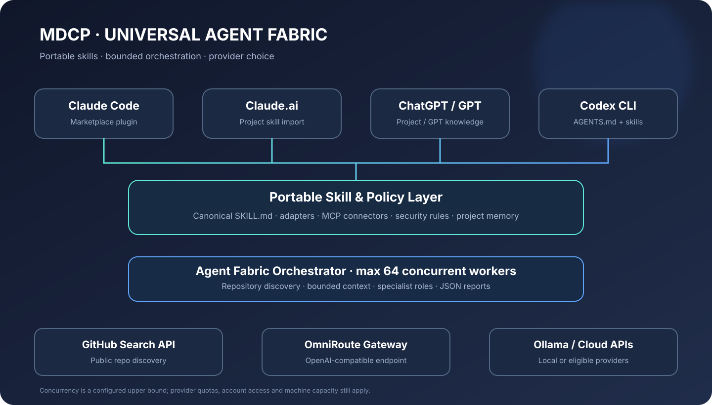

# MDCP — Master Developer Claude Plugin

[](https://github.com/Badhon-00/MDCP/actions/workflows/validate.yml)
[](LICENSE)

**A modular developer toolkit for coding agents.** MDCP combines curated skills, platform-specific instruction adapters, optional MCP connector guidance, and a local project-memory utility designed to reduce repeated context preparation.

> **V2000 architecture track:** a roadmap/version label, not a claim that 2,000 files, agents, plugins, or integrations are implemented. Features are counted only when implemented and validated.

## Explore the skills visually

Browse the searchable, phone-friendly [MDCP Skill Explorer](https://badhon-00.github.io/MDCP/) to find skills by task or category, open the source instructions, and copy skill links. The catalog is generated from the actual `skills/*/SKILL.md` files by GitHub Actions.

## Existing skill library

MDCP currently includes **82 curated skills** across core development, security, backend/data, frontend, design, Three.js, workflows, clean-room app reconstruction, and skill/plugin/MCP authoring. See the [skill catalog](skills/) and [third-party notices](THIRD_PARTY_NOTICES.md) for source and license details.

## Platform coverage

| Platform | Included guidance | Important boundary |
|---|---|---|
| Claude Code | Existing marketplace plugin and Claude adapter | Native plugin/skill installation |
| OpenAI Codex | `AGENTS.md` and Codex adapter | Host must support the documented instruction discovery |
| ChatGPT | Project / Custom GPT setup guide | Not an automatically installed ChatGPT plugin |
| Gemini | Portable `GEMINI.md` adapter | Add to a supported workspace manually |
| Cursor | `.cursorrules` starter | Follow current Cursor rules support |
| Windsurf | `.windsurfrules` starter | Follow current Windsurf rules support |
| Other agents | Portable Markdown context | Adapt to the host's own format |

See [platform adapters](adapters/README.md) and the [universal architecture](docs/UNIVERSAL_AI_ARCHITECTURE.md).

**Using Claude on Android or iPhone?** Follow the [Claude.ai mobile-first setup guide](docs/CLAUDE_AI_MOBILE.md) for Project instructions, skill uploads, remote MCP connectors, and phone-friendly workflows.

## Token efficiency and project memory

LLM inference is not free and MDCP cannot guarantee zero token consumption or a fixed 80–90% reduction. It helps avoid unnecessary repeated reads by creating a small, bounded project-context pack and storing explicit decisions locally.

### Quick start

```bash
# Build a compact context pack (stdout)
python3 tools/mdcp_memory.py pack --root . --max-chars 12000

# Save a project decision locally
python3 tools/mdcp_memory.py remember "API versioning" "Use /v1 routes for public endpoints."

# Search saved decisions
python3 tools/mdcp_memory.py search "API"

# Export or delete a memory
python3 tools/mdcp_memory.py export
python3 tools/mdcp_memory.py forget 1
```

The database lives in `.mdcp/memory.sqlite3` and is ignored by Git by default. The utility does **not** write to ChatGPT Memory, Claude memory, Codex session memory, or any provider-private storage. Feed the generated context pack to the agent or configure the host to load it. Read [Token Efficiency & Memory](docs/TOKEN_EFFICIENCY_AND_MEMORY.md).

## Free and local LLM routing (OmniRoute + Ollama)

MDCP includes an integration pack for [OmniRoute](https://github.com/akoeraste/omniroute), a separately maintained open-source AI gateway. It provides one local OpenAI-compatible endpoint, provider/model routing, and fallback according to the providers and accounts you configure. MDCP does not vendor or claim ownership of OmniRoute.

- **Local/private:** Ollama serves models on your own machine. No hosted API quota, but inference is limited by your hardware, memory and electricity.
- **Free hosted tiers:** connect eligible providers such as Gemini API, Groq, Cerebras, Cloudflare Workers AI, NVIDIA NIM, Hugging Face or OpenRouter free models where currently offered. Each provider controls its own quotas, regions, eligibility, model access and terms.
- **Routing:** OmniRoute can route compatible coding CLIs through one local gateway and use configured fallback candidates when supported.
- **Claude Code + Codex CLI:** use OmniRoute's documented CLI launch/configuration commands. Do not replace your existing provider credentials or config blindly.
- **Claude.ai and ChatGPT web apps:** skills/instructions can be reused there, but those hosted chat interfaces do not become OmniRoute clients merely by installing this repository. A supported API/action or compatible client is required.

### Quick start

```bash
# Install the upstream gateway (review its docs and release first)
npm install -g omniroute
omniroute

# Open http://localhost:20128, connect providers you are eligible to use,
# and copy the gateway API key from Dashboard -> Endpoints.

# Launch compatible coding CLIs through the gateway
omniroute run claude --model auto/coding
omniroute run codex --model auto/coding

# Or use the upstream guided configuration
omniroute configure claude
omniroute configure codex

# Optional: connect the local Ollama service in OmniRoute's Providers UI.
# Install Ollama separately, start it, and pull a model that fits your hardware.
ollama serve
ollama pull qwen2.5-coder:7b
```

See [OmniRoute + Ollama integration guide](integrations/omniroute/README.md), [free provider notes](integrations/omniroute/FREE_PROVIDERS.md), and the reusable [OmniRoute routing skill](skills/omniroute-free-llm-routing/SKILL.md).

**No unlimited hosted usage promise:** free tiers are rate-limited and can change or disappear. MDCP does not bypass quotas, rotate accounts to evade limits, or guarantee a zero-cost route. For genuinely uncapped local usage, run Ollama locally subject to hardware constraints.


## Universal Agent Fabric — Claude, ChatGPT and Codex

MDCP now includes a portable skill package and an **opt-in agent-fabric CLI** for multi-repository discovery and parallel model-assisted analysis.

### Cross-platform skill installation

- **Claude Code:** use the existing MDCP marketplace plugin; the new skills live under `skills/` and are also mirrored to `.agents/skills/` for portable agent discovery.
- **Claude.ai:** import the skill Markdown files or the packaged skill directory into a Project/Custom workflow where file-based instructions are supported. Claude.ai does not install a Claude Code plugin.
- **Codex CLI:** reads the repository's `AGENTS.md` and can use the portable `.agents/skills/` material as task guidance.
- **ChatGPT:** import the skill Markdown or ZIP into a Project/custom GPT knowledge/instructions where supported. ChatGPT does not load a Claude Code marketplace plugin directly.
- **OmniRoute:** routes compatible API/CLI clients to providers you configured. It cannot transparently replace the hosted Claude.ai or ChatGPT model backends.

See [cross-platform installation](docs/CROSS_PLATFORM_SKILLS.md).

### Agent fabric: repository discovery and parallel analysis

```bash
# Search public GitHub repositories (max 64 concurrent search requests)
python3 -m pip install -e ".[dev]"
mdcp-fabric search "mcp server" "agent framework" --limit 30 --workers 16

# Run specialist agents against a local repository through an OpenAI-compatible API
export MDCP_LLM_BASE_URL="http://localhost:20128/v1"
export MDCP_LLM_API_KEY="your-local-gateway-key"
export MDCP_LLM_MODEL="your-configured-model"
mdcp-fabric analyze . --agents 8 --max-parallel 8

# Increase to 64 only if your gateway/provider capacity allows it
mdcp-fabric analyze . --agents 64 --max-parallel 64 --max-files 100
```

The runner has a hard ceiling of 64 concurrent workers, defaults to 8, uses bounded file excerpts, and returns structured findings. Repository search uses GitHub's public Search API and obeys API rate limits. Model analysis requires a compatible endpoint and can incur provider costs. The number of configured specialist profiles is not the same as the number of simultaneously running model sessions.

### Token-aware project context

Use `mdcp-fabric context . --max-chars 12000` to create a bounded context bundle. The fabric avoids sending irrelevant files, excludes common generated/vendor paths, and records file hashes in a local cache. A cache hit means the file summary can be reused locally; it does not mean the model has permanent provider-side memory or that tokens are free.

Token savings vary by repository and provider. MDCP does not claim a guaranteed 90% reduction. See [agent fabric architecture](docs/AGENT_FABRIC.md) and [token measurement](docs/TOKEN_EFFICIENCY_AND_MEMORY.md).

### Visual architecture



### Included specialist skills

Repository discovery, architecture mapping, security review, performance profiling, test planning, documentation, dependency auditing, API design, database review, frontend review, backend review, DevOps, accessibility, refactoring, incident triage and release verification. Skills are portable Markdown playbooks; execution depends on the host's available tools.

## Connectors and MCP

MDCP documents optional connector categories including source control, documentation, databases, design, browser testing, deployment, observability and team workflows. Connectors must be installed and authenticated in the host environment. Availability varies by provider and account.

Start with [connector safety and setup](connectors/README.md). Never commit API keys or tokens. Use least-privilege credentials and require approval for destructive or externally visible actions.

## Repository map

```text
MDCP/
├── skills/                 # Curated task-specific skill library
├── plugins/                # Plugin resources
├── mcp/                    # Existing MCP setup notes
├── adapters/               # Claude, Codex, ChatGPT, Gemini, Cursor, Windsurf
├── connectors/             # Connector guidance and safe example config
├── docs/                   # Architecture and memory documentation
├── tools/                  # Local context/memory utilities
├── tests/                  # Utility tests
├── MDCP_CONTEXT.md         # Short portable project brief
├── AGENTS.md               # Repository agent instructions
└── README.md
```

## Skill health report

Inspect every packaged skill, catch broken local links, and generate a deterministic Markdown or JSON report:

```bash
python3 scripts/skill_report.py
python3 scripts/skill_report.py --format json
python3 scripts/skill_report.py --check
```

The report runs in CI and appears in the GitHub Actions job summary. It checks documentation structure, not security or host compatibility. See [Skill Health](docs/SKILL_HEALTH.md).

## Quality and security

- Curated skills retain their upstream licenses and attribution.
- Validate repository metadata with `python3 scripts/validate.py`.
- Run memory utility tests with `python3 -m unittest tests/test_mdcp_memory.py`.
- Third-party skills and MCP servers are not automatically security-audited. Review before use.
- Rules guide agents; tests, type checkers, scanners and human review determine whether changes are correct.

## Roadmap

- [x] Portable project context and agent adapters
- [x] Local SQLite decision memory and bounded context packer
- [x] Connector setup and least-privilege guidance
- [ ] Verified integration tests for each host version
- [ ] Optional memory indexing and semantic retrieval
- [ ] Expanded language-specific skills based on tested demand
- [ ] CI coverage for all utilities and supported runtimes

## Contributing

Issues and pull requests are welcome. Read [CONTRIBUTING.md](CONTRIBUTING.md), run the validator, and include tests for behavior changes. Security reports: [SECURITY.md](SECURITY.md).

## License

MIT for MDCP's original files. Bundled skills retain their own licenses; see [THIRD_PARTY_NOTICES.md](THIRD_PARTY_NOTICES.md) and [licenses/](licenses/).
